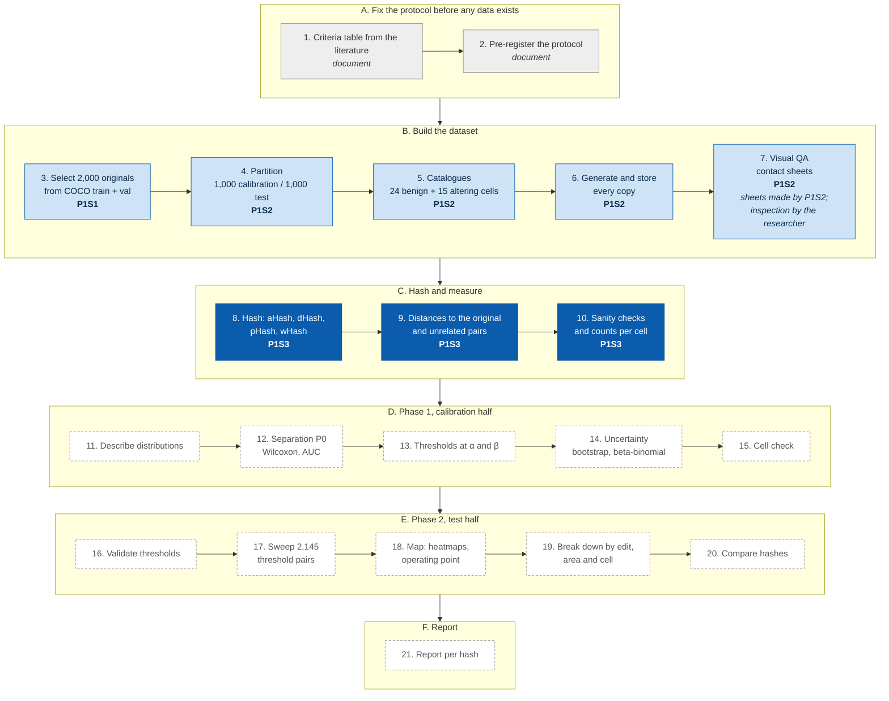

# P1S3 Hash and Distances (step 3)

Hashes every stored original and copy of the Distance-vs-Accuracy experiment with aHash, dHash, pHash and
wHash, and measures the Hamming distances the analysis uses (protocol steps 8–10: hashing, distances,
sanity checks and counts). It reads **only** the output folder of step 2 (`P1S2_Copy_Generator`) and never
regenerates a copy: every PNG's SHA-256 is recomputed against step 2's manifests before it is hashed.

## Where this script sits in the experiment

The 21 steps of the experiment protocol (final version, approved 29 October 2026). Each script reads only the output of the script before it.

**Dark blue:** this repository (P1S3), protocol steps 8, 9, 10. **Light blue:** the finished scripts before it (P1S1 · P1S1_COCO_Dataset_Retriever, step 3; P1S2 · P1S2_Copy_Generator, steps 4–7). **Grey:** protocol documents, not scripts. **Dashed:** scripts not written yet.

## What it does

1. **Checks step 2's records.** `run_metadata.json` must hold a summary (the run finished); both manifests
   must agree on each original's half; every original must list the same cells; the number of `ok` copies
   must match step 2's summary; every PNG under `originals/` and `copies/` must be listed.
2. **Hashes (step 8).** Each original and each copy with status `ok`: the file is read, its SHA-256 compared
   with the manifest (stop on mismatch or missing file), the verified bytes decoded once to 8-bit RGB, and
   the same image given to the four ImageHash 4.3.2 calls of protocol section 6:

   | Hash | Call |
   | --- | --- |
   | aHash | `average_hash(img, hash_size=8)` |
   | dHash | `dhash(img, hash_size=8)` |
   | pHash | `phash(img, hash_size=8, highfreq_factor=4)` |
   | wHash | `whash(img, hash_size=8, image_scale=128, mode="haar", remove_max_haar_ll=True)` |

   `remove_max_haar_ll=True` is the library default for the protocol's call; it is written out so the
   record shows it (the coarsest Haar LL band is zeroed and the image reconstructed before the 8×8 low band
   is taken).
3. **Distances (step 9).** For each hash, the Hamming distance in bits (0–64) between every `ok` copy and
   its original. Not-applicable cells give no distance; they are counted. **Reference pairs:** within each
   half, the originals (sorted by id) are permuted with a seed derived from the master seed
   (`SHA-256(master seed | "reference_pairs" | half)`), and pair *i* joins the *i*-th and (*i*+1)-th
   original, wrapping around. With 1,000 originals per half this gives 1,000 pairs per half; every original
   is in exactly two pairs, never with itself, and no pair repeats.
4. **Sanity checks (step 10).** Every image is hashed twice and must give identical hashes; every lossless
   reference is re-read from disk with a fresh decode and must be at distance 0 from its first hash, for all
   four hashes. Counts of originals per (half, cell), ok and not applicable, go to `cell_counts.csv`.

If any check fails, the run stops and writes nothing.

## Output

| File | Contents |
| --- | --- |
| `hashes.csv` | One row per stored image: original/cell, file, SHA-256, four hashes as 16 hex digits |
| `distances.csv` | One row per (original, cell, hash): half, cell parameters, target and mask share, changed-pixel share, distance in bits |
| `reference_pairs.csv` | One row per (pair, hash): half, the two originals, distance in bits |
| `cell_counts.csv` | Originals per (half, cell): total, ok, not applicable |
| `run_metadata.json` | Settings, master seed, Python and package versions (including SciPy), SHA-256 of step 2's records and of this script, hash calls, pair rule, sanity results, counts, SHA-256 of every output |

## Usage

    python3 -m venv .venv && source .venv/bin/activate
    python3 -m pip install -r requirements.txt
    python3 -m unittest discover -s tests -v                        # self-test, no network
    python3 hash_distances.py --in ~/DVA_copies --out ~/DVA_hashes  # IN = step-2 output folder

Options: `--workers` (default: all cores; the output does not depend on it), `--expect-scipy VERSION`
(stop unless the installed SciPy is exactly this version; see below), `--allow-unpinned` (run
with package versions other than the protocol pins; the differences are recorded in `run_metadata.json`.
For tests only: the experiment runs in the reference environment). OUT must be a new or empty folder.

## Reproducibility

Pinned versions: numpy 2.5.3, Pillow 12.3.0, ImageHash 4.3.2, PyWavelets 1.8.0 (and SciPy 1.18.1 in
`requirements.txt`, taken from the step-3 pilot environment); the script refuses to run
with others unless `--allow-unpinned` is given. ImageHash's pHash needs SciPy (`scipy.fftpack.dct`).
SciPy is **detected at run time**: the script prints it and records it in `run_metadata.json` (`scipy`:
detected, expected, matches). The computation never changes with the version; only the check adapts. Without
`--expect-scipy` the detected version is accepted (a pilot, or the first run on a machine); with
`--expect-scipy` the run stops on any other version, so a later run can be tied to the version an earlier
run recorded. Resizing inside ImageHash uses Pillow's Lanczos
filter, so exact hashes are guaranteed only in the same software environment.

## Licence

MIT, © 2026 Jose Luis del Valle.
